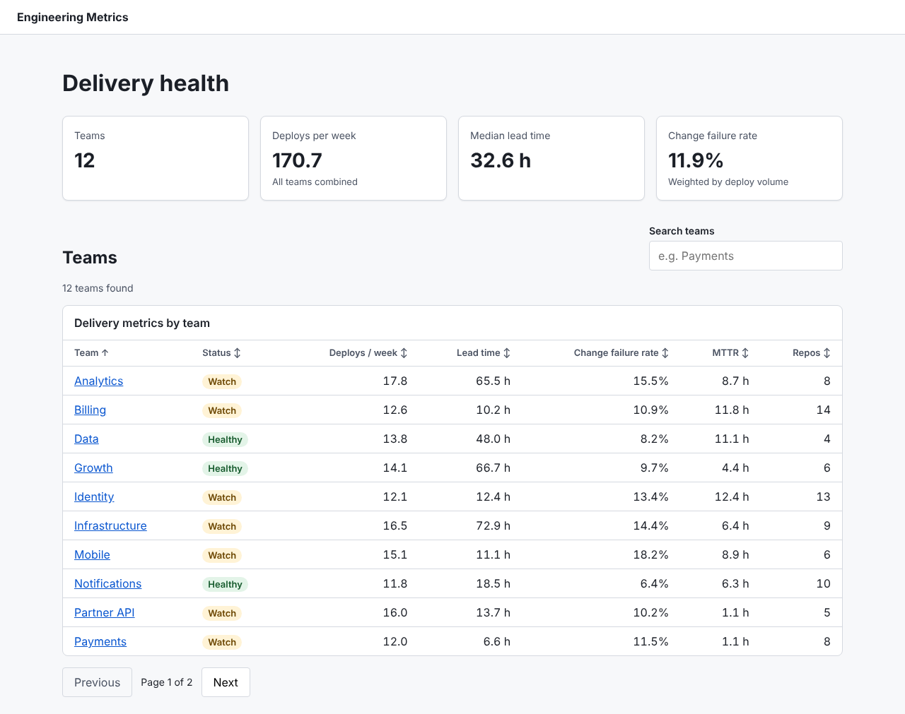
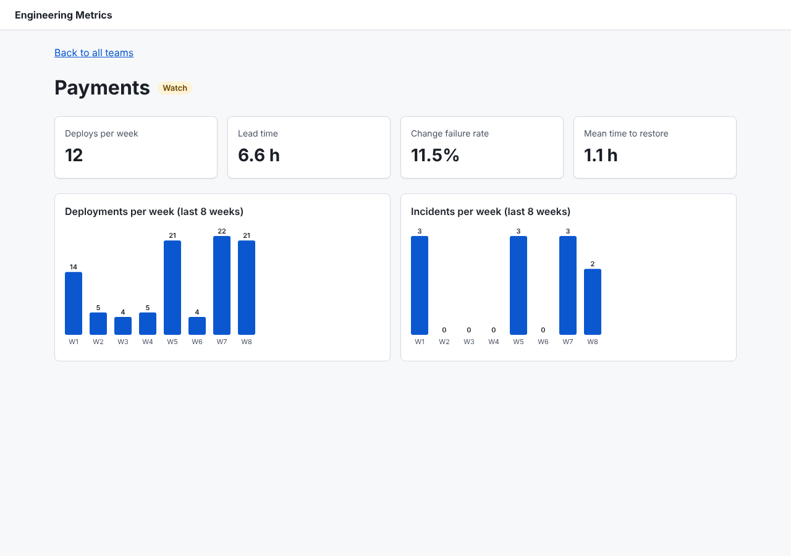

# Engineering Metrics Dashboard (Nuxt + Vue 3)

A delivery-health dashboard for engineering managers: deployments, lead time, change failure rate and time to restore, from organisation level down to a single team.

This is a Nuxt and Vue 3 rebuild of my [Engineering Metrics Dashboard](https://github.com/chandrika1993/Internal-Engineering-Metrics-Dashboard), originally written in Next.js and React. I built it to show how I structure a Vue codebase: a typed component library, URL-driven state, server-side data shaping, and accessibility and testing treated as part of the work rather than an afterthought.



## Stack

| Area | Choice |
| --- | --- |
| Framework | Nuxt 4 (SSR), Vue 3 Composition API, `<script setup>` |
| Language | TypeScript in strict mode, shared types between server and client |
| API | Nitro server routes, query validation with Zod |
| Unit tests | Vitest, Vue Test Utils, happy-dom |
| E2E tests | Playwright with axe-core accessibility scans |
| CI | GitHub Actions: typecheck, unit tests, E2E |

## Running it

```bash
npm install
npm run dev          # http://localhost:3000

npm test             # unit tests
npm run typecheck    # vue-tsc via nuxt typecheck
npx playwright install chromium
npm run test:e2e     # builds the app and runs E2E + accessibility tests
```

## Project structure

```
app/
  components/ui/     Reusable, framework-agnostic UI components (no Nuxt auto-imports)
  composables/       useTeamTableState: URL-synced table state
  pages/             Overview and team drill-down
  assets/css/        Design tokens and base styles
server/
  api/               /api/overview, /api/teams, /api/teams/:id
  utils/             Seeded demo data
shared/
  types/             Types used by both server and client
  utils/             Pure filtering, sorting and pagination logic
tests/
  unit/              Component and utility tests
  e2e/               User flows and axe scans
docs/
  MIGRATION.md       How I would migrate a server-rendered legacy frontend to this architecture
```

## Design decisions

**A small component library with explicit contracts.** `UiDataTable`, `UiSearchInput`, `UiPagination`, `UiKpiCard`, `UiStatusBadge` and `UiBarChart` are typed with `defineProps` and `defineEmits`, read only design tokens for styling, and import everything explicitly. That keeps them portable (they could move into a shared package unchanged) and lets them be tested without a Nuxt runtime. `UiDataTable` is a generic component (`generic="T, K"`), so column keys and slot props are type-checked against the row type.

**The URL is the source of truth for table state.** Search, sort and page live in the query string. Views can be bookmarked and shared, the back button works, and the server render matches what the client shows.

**The server shapes the data.** Filtering, sorting and pagination run in the API, and the client receives only the rows it renders. Query parameters are validated with Zod, so an invalid sort key or page size returns a 400 instead of reaching the data layer. The same pure functions in `shared/utils` are used by the API and covered by unit tests.

**Every async view has loading, empty and error states.** The table exposes `aria-busy` while loading, shows a specific empty message for searches with no matches, and offers a retry when the request fails.

## Accessibility

Built against WCAG 2.2 AA and checked automatically with axe-core in the E2E suite (A and AA rule sets, zero violations on both pages).

- Semantic table with a caption, `scope="col"` headers, and `aria-sort` on the active column
- Sort controls are real `<button>` elements, so they work with keyboard and screen readers
- Search results count is announced through a polite live region
- Status badges carry text, so meaning never depends on colour alone
- Charts are decorative SVG backed by a visually hidden data table
- Skip link, visible focus styles, `lang` attribute, reduced-motion support
- Colour tokens meet AA contrast on their backgrounds

## Testing

- **Unit (26 tests):** sorting is numeric and stable, pagination clamps out-of-range pages, debounce emits once with the last value, the table exposes the correct `aria-sort`, label/input association, pagination boundaries.
- **E2E (9 tests):** KPIs and table render, search updates the URL and survives a reload, keyboard sorting, pagination, drill-down navigation, 404 state, and axe scans of both pages.


